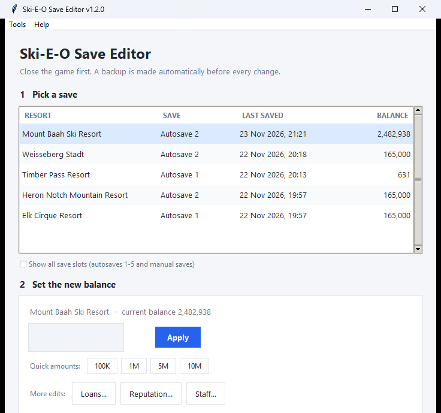
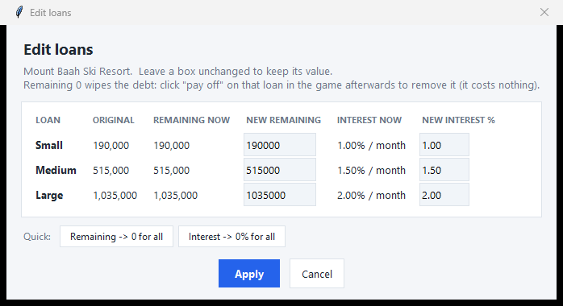
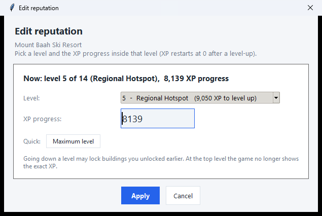
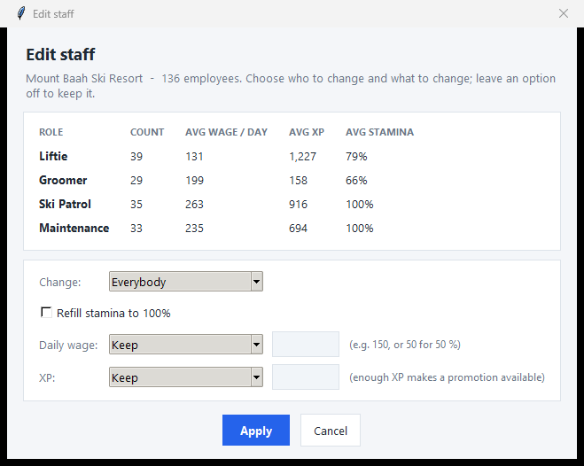

# Ski-E-O Save Editor

A small, open-source save editor for **Ski-E-O! Ski Resort Tycoon** (single-player). Pick a
save in a simple window and change:

- **Money balance**
- **Loans** (remaining amount and interest, custom values)
- **Reputation** (level 1-14 and XP progress)
- **Staff** (refill stamina, set or scale daily wages, set XP, for everybody or one role)

Every change makes a backup first, writes the file safely, and verifies the result. Backups
can be restored from the same window.

> Unofficial fan tool. Not affiliated with the game's developers. Use at your own risk.



## Download

**Windows (no install):**
1. Download `ski_e_o_save_editor_gui_v1.2.0.zip` from the [Releases](../../releases) page.
2. **Extract the whole zip** (right-click > Extract All). Do not run it from inside the zip.
3. Open the extracted folder and run `ski_e_o_save_editor_gui.exe`.
   Keep the `_internal` folder next to the `.exe`.

**From source (any system with Python 3.10+, no extra packages):**
```
python ski_e_o_save_editor_gui.py     # window version
python ski_e_o_save_editor.py         # console version
```
On Windows you can also double-click `run_gui.bat`.

### About antivirus warnings (please read)

The `.exe` is an unsigned [PyInstaller](https://pyinstaller.org) build, and antivirus
engines flag such files by mistake fairly often.

- VirusTotal scan of the v1.2.0 `.exe`: **3 of 70 engines flag it** (Arctic Wolf, SecureAge,
  Skyhigh, with generic labels such as `BehavesLike.Win64.Backdoor.tc`); the other 67 found
  nothing, **including Microsoft Defender**. [Scan report](https://www.virustotal.com/gui/file/1ad4df5450b8f3109d4632391e4ed66acd8a92106dc91a3692d9ce887528b86d)
- The zip itself scans as 0 of 65, but VirusTotal mostly checks the archive container, so the
  `.exe` result above is the one that matters.

I believe any detections are false positives, but you do not have to take my word for it:

- The tool has **no network code**. It only reads/writes save files in
  `%LOCALAPPDATA%\Ski-E-O\SaveGames`, writes backups to your Documents folder, and runs
  `tasklist` once to check whether the game is running. Read the source to check.
- If you would rather not run an `.exe`, **run the Python source instead** (see above),
  or build the `.exe` yourself (see below).
- SHA-256 of `ski_e_o_save_editor_gui.exe` inside the zip:
  `1AD4DF5450B8F3109D4632391E4ED66ACD8A92106DC91A3692D9CE887528B86D`
- SHA-256 of the zip itself:
  `1F0A3A3FCF096A4DE7BCBB9E93AC395D82E4AFC702B3EC3E3EC0C36DCE1C6360`

Windows SmartScreen may also show a warning because the file is new and unsigned.

## How to use

1. **Close the game completely.**
2. *(Recommended)* In Steam, right-click the game > Properties > General, and turn off
   **Steam Cloud** for it. Otherwise Steam can bring back your old save.
3. Start the tool.
4. **Step 1 - Pick a save.** The list shows one row per resort (its newest save) with the
   current balance. Tick *Show all save slots* to see every autosave and manual save.
5. **Step 2 - Change something.** Use the balance box and **Apply**, or one of the
   **More edits** buttons (below). Every change shows a confirmation first.
6. Start the game and load the save.

### Money balance
Type a whole number (for example `2000000`) or use the quick-amount buttons, then **Apply**.



### Loans
**Loans...** lists each active loan with its original amount, remaining amount and monthly
interest. Type new values (any remaining amount from 0, any interest from 0% to 100% per
month), or use the quick buttons *Remaining -> 0 for all* and *Interest -> 0% for all*.
A loan with **0 remaining** stays on the list with a *pay off* button; click it in the game
to remove the loan, it costs nothing.



### Reputation
**Reputation...** sets the level (1-14) and the XP progress **inside that level**
(XP restarts at 0 after a level-up). The XP needed to level up:

| Level | Name | XP to level up |
|---|---|---|
| 1 | Small Hill | 280 |
| 2 | Hidden Gem | 1,050 |
| 3 | Local Favorite | 2,300 |
| 4 | Powder Stash | 4,950 |
| 5 | Regional Hotspot | 9,050 |
| 6 | Rising Star | 18,700 |
| 7 | Destination Resort | 35,000 |
| 8 | Powder Mecca | 65,000 |
| 9 | Premier Mountain | 130,000 |
| 10 | Elite Resort | 230,000 |
| 11 | Prestigious Destination | 350,000 |
| 12 | World Class | 600,000 |
| 13 | Iconic Destination | 900,000 |
| 14 | Legendary Resort | maximum |

Going down a level may lock buildings you unlocked earlier. At the top level the game no
longer shows the exact XP. If you set XP at or above the level-up amount, the game will most
likely level up when you load the save (the tool warns you).



### Staff
**Staff...** shows each role (liftie, groomer, ski patrol, maintenance) with its headcount and
average wage, XP and stamina. Choose *Everybody* or one role, then any of:
**refill stamina to 100%**, **daily wage** (set to an amount, or scale by a percent; never
below 1), **XP** (enough XP makes a promotion available in the game). Wages and XP stay as set;
stamina drains normally while employees work.

## Backups and restoring

Before every change the tool copies the save (and its `.meta` file) to:

```
Documents\Ski-E-O Save Editor Backups\<date_time>\
```

To undo a change use **Tools > Restore a backup...** (or **Tools > Open backups folder** to
copy files back by hand into `%LOCALAPPDATA%\Ski-E-O\SaveGames`). Restoring also backs up
your current file first. Backups made by older versions (folder `Ski-E-O Balance Editor
Backups`) are still listed.

## Where are the saves?

```
%LOCALAPPDATA%\Ski-E-O\SaveGames
```
(for example `C:\Users\<you>\AppData\Local\Ski-E-O\SaveGames`). Paste that into the
Windows Explorer address bar to open it. The window has **Tools > Change save folder...**
if yours is elsewhere.

## Safety checks built in

- Refuses to edit anything that is not a recognised save, or whose layout it does not
  understand, rather than guessing.
- Warns if the game seems to be running.
- Warns if the save version differs from the version this tool was tested with.
- Writes through a temporary file, verifies the result, and puts the original back if
  verification fails.
- The balance is a 32-bit number: allowed range is -2,147,483,648 to 2,147,483,647.
  Huge values can overflow inside the game, so something like 1-10 million is safer.

## Limitations

- Tested with save version 51.102 on Windows. A game update can change the save format;
  the tool is designed to stop with a message instead of damaging a save, but always keep
  your own backups.
- The hiring pool (people you could still hire) is not edited, only your current staff.
- Editing a save may affect achievements or leaderboards if the game ever adds them.
  Use it for single-player fun only.

## Build the .exe yourself

```
pip install pyinstaller
pyinstaller --onedir --windowed --name ski_e_o_save_editor_gui ski_e_o_save_editor_gui.py
```
The result is in `dist\ski_e_o_save_editor_gui\`. Or run `build_exe.bat`, which also
creates the zip. Building yourself gives a different file hash than the release.

## Tests

```
python -m unittest discover -s tests
```
The tests use synthetic saves, so no real save files are in this repository.

## Reporting problems

Open an issue and include the tool version, what you did, and the message shown.
**Do not upload your save file** unless asked: it contains your Steam ID.

## License

MIT, see [LICENSE](LICENSE).
